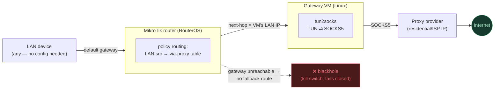

# Mikrotik Proxy Gateway

[](LICENSE)
[](README.zh-CN.md)

**English | [简体中文](README.zh-CN.md)**

Routes every device on a LAN through a static (non-rotating) proxy exit
IP, using policy-based routing on a MikroTik router and a small Linux VM
running [tun2socks](https://github.com/xjasonlyu/tun2socks) as the
SOCKS5-to-TUN gateway.

No device needs any per-app proxy configuration — the redirection happens
transparently at the router, for every device on the LAN, including DNS.

## Why this exists

Consumer VPN apps rotate IPs, cap devices, or don't run on routers. This
pattern instead gives a whole LAN a single, stable exit IP backed by a
paid static proxy (residential/ISP proxy) service, with:

- **A kill switch** — if the proxy gateway goes down, affected devices
  lose internet instead of silently falling back to the real ISP IP.
- **No DNS leak** — DNS queries are routed through the same tunnel as
  everything else, not resolved locally by the router.
- **An instant, single-command rollback** to normal internet.

It generalizes beyond the exact hardware used while building it — see
[docs/USE-CASES.md](docs/USE-CASES.md) for running the same pattern on
different routers, hosts, and proxy types (whole-home, a single test
device, a small office/guest network, a stable outbound IP for CI, a
dedicated low-power box instead of a daily-use PC, a cloud VPS instead of
a local VM, and so on).

## Architecture



1. A LAN client sends traffic as normal; its default gateway is still the
   router (clients need zero configuration).
2. The router has a policy routing rule that, for LAN source addresses,
   looks up a next-hop of the gateway VM instead of the normal WAN — this
   happens transparently, the client never knows.
3. The VM runs `tun2socks`, which owns a `tun0` interface. Traffic
   forwarded to the VM is NAT'd onto `tun0`, which `tun2socks` relays out
   over a SOCKS5 connection to the proxy provider.
4. If the proxy/VM is unreachable, the router's route lookup fails and
   the traffic is **dropped**, not rerouted to the real WAN — this is the
   kill switch. (A brief upstream ISP glitch behaves differently from
   this — see [docs/OPERATIONS.md](docs/OPERATIONS.md) → "Failure modes.")

See [docs/ARCHITECTURE.md](docs/ARCHITECTURE.md) for the full breakdown,
including why a MikroTik can't do this with a native proxy client and why
a VM gateway is required, and a request-by-request sequence diagram.

## Getting started

New build, from scratch: [docs/SETUP.md](docs/SETUP.md) — covers the VM,
the gateway service, the watchdogs, and the router configuration, in the
order that keeps your internet up the whole time you're building it.

Already built, just want to know how it behaves day to day:
[docs/OPERATIONS.md](docs/OPERATIONS.md) answers the two most common
questions people ask about a setup like this —

- **"Can I disconnect/shut down the PC?"** → No, read why.
- **"What happens if the PC restarts?"** → Mostly automatic, with one
  caveat. Read it before you rely on it.

Something's actually broken right now:
[docs/TROUBLESHOOTING.md](docs/TROUBLESHOOTING.md) — every real issue hit
while building and running this, organized by symptom.

A service/app is flagging "VPN or proxy detected":
[docs/DETECTION.md](docs/DETECTION.md) — what's actually checkable
(IP reputation, timezone/locale, WebRTC, TLS/TCP fingerprinting, IPv6)
and what's fixable from this side versus inherent to the architecture.

## Status

Working, in daily use (see the live deployment's own build log referenced
throughout the docs for what that looked like in practice).

## Repo layout

```
docs/
  ARCHITECTURE.md      full design, diagrams, and why native MikroTik proxying isn't possible
  SETUP.md              step-by-step build instructions (VM, service, router)
  OPERATIONS.md         reboot behavior, disconnecting the PC, emergency bypass, failure modes
  TROUBLESHOOTING.md    every real issue hit while building this, and the fix
  DETECTION.md          why a service might flag "VPN/Proxy detected" and what's fixable
  USE-CASES.md          variations: different hardware, hosts, proxy types, scenarios
  LEGAL.md              responsible/lawful use, licensing of the proxy service itself, disclaimer
configs/
  proxygw.service.template          systemd unit for the tun2socks gateway
  proxygw-net.sh                     post-up network/kill-switch script run by the service
  proxygw-healthcheck.sh/.service/.timer   in-VM tunnel watchdog
  vm-watchdog.ps1.template            host-side watchdog for a hung/crashed VM
  vm-watchdog-launcher.vbs.template   silent launcher for the above (no console-window flash)
  mikrotik-setup.rsc.template        RouterOS script with the policy routing rules
  decodo.env.example                  proxy credentials file format (placeholders only)
AGENTS.md / CLAUDE.md   context for AI coding agents picking this project up
local/                   (git-ignored) real credentials/IPs for a specific
                          deployment — never committed, not part of this repo
```

## Who this is for / contributing

Built around one specific stack (MikroTik + VirtualBox + Decodo) but the
pattern — policy routing to a SOCKS5-aware gateway with a fail-closed
kill switch — isn't tied to any of those three specifically. If you adapt
this to different hardware, a different proxy type, or different tunnel
software, see [docs/USE-CASES.md](docs/USE-CASES.md) first, and
[CONTRIBUTING.md](CONTRIBUTING.md) if you'd like to contribute that
adaptation back.

## Legal and responsible use

This repo is infrastructure config, not a service — it doesn't provide a
proxy, and using it still means agreeing to whatever proxy provider you
choose and to the terms of every site you access through it. Read
[docs/LEGAL.md](docs/LEGAL.md) before relying on this for anything beyond
personal/home use.

## Credentials and IPs

This repo contains **no real credentials, IPs, or identifying network
details** — every config file uses placeholders. The actual working
values for a given deployment live in `local/`, which is git-ignored and
stays on the machine that built it. If you're reproducing this setup,
fill in your own values following `configs/decodo.env.example` and
`configs/mikrotik-setup.rsc.template`.

## License

MIT — see [LICENSE](LICENSE). This covers the configuration and
documentation in this repo only — see [docs/LEGAL.md](docs/LEGAL.md) for
what it doesn't cover (the proxy service itself, target sites' own
terms).
