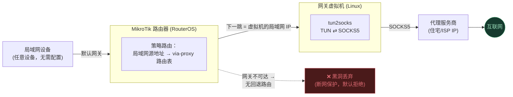

# Mikrotik Proxy Gateway（MikroTik 代理网关)

[](LICENSE)
[](README.md)

**[English](README.md) | 简体中文**

> 本文档由英文版翻译而来，是本项目的主要说明文件。其余更详细的文档（`docs/` 目录）
> 目前仅提供英文版本。

通过 MikroTik 路由器上的策略路由（policy-based routing）和一台运行
[tun2socks](https://github.com/xjasonlyu/tun2socks) 的轻量 Linux 虚拟机
（作为 SOCKS5↔TUN 网关），让局域网内的所有设备都经由一个**固定不变**
（非轮换）的代理出口 IP 上网。

任何设备都**不需要**单独配置代理——流量转发在路由器层面透明完成，
局域网内所有设备（包括 DNS 查询)都会自动生效。

## 为什么做这个项目

普通消费级 VPN 应用会轮换 IP、限制设备数量，而且大多不能直接跑在路由器上。
这个方案则是给整个局域网提供**一个稳定的出口 IP**（基于付费的静态
住宅/ISP 代理服务），并且带有：

- **断网保护（kill switch）**——如果代理网关失效，受影响的设备会直接
  断网，而不是悄悄地回退到你真实的 ISP IP。
- **无 DNS 泄漏**——DNS 查询和其他流量走同一条隧道，不会被路由器在本地
  解析。
- **一条命令即可瞬间回滚**到正常上网状态。

这套模式并不局限于搭建时用到的具体硬件/软件——参见
[docs/USE-CASES.md](docs/USE-CASES.md)（英文）了解如何在不同路由器、
不同主机、不同代理类型上实现同样的模式（整个家庭网络、单台测试设备、
小型办公室/访客网络、给 CI 使用的稳定出口 IP、用低功耗专用设备代替日常
使用的电脑、用云端 VPS 代替本地虚拟机，等等）。

## 架构



1. 局域网客户端正常发送流量；它的默认网关依然是路由器（客户端**完全
   不需要任何配置**)。
2. 路由器有一条策略路由规则：对于局域网源地址，查找的下一跳是网关
   虚拟机，而不是正常的 WAN 出口——这一切对客户端完全透明。
3. 虚拟机运行 `tun2socks`，拥有一个 `tun0` 接口。转发到虚拟机的流量会
   被 NAT 到 `tun0`，再由 `tun2socks` 通过 SOCKS5 连接转发给代理服务商。
4. 如果代理/虚拟机不可达，路由器的路由查找会失败，流量会被**直接
   丢弃**，而不是改走真实的 WAN——这就是断网保护机制。（注意：上游 ISP
   短暂抖动时的表现与此不同——详见
   [docs/OPERATIONS.md](docs/OPERATIONS.md) 的 "Failure modes" 一节。）

完整设计细节，包括为什么 MikroTik 无法用自带的代理客户端实现、为什么
必须用一台虚拟机作网关，以及逐请求的时序图，参见
[docs/ARCHITECTURE.md](docs/ARCHITECTURE.md)（英文）。

## 快速开始

**从零搭建**：参见 [docs/SETUP.md](docs/SETUP.md)（英文）——涵盖虚拟机、
网关服务、看门狗（watchdog）脚本，以及路由器配置，并按照不会中断你
日常上网的顺序排列。

**已经搭好了，想了解日常使用注意事项**：参见
[docs/OPERATIONS.md](docs/OPERATIONS.md)（英文），其中回答了关于这类
方案最常被问到的两个问题——

- **"我能直接断开/关掉这台电脑吗？"** → 不能，文档里说明了原因。
- **"电脑重启后会怎样？"** → 大部分会自动恢复，但有一个需要注意的例外，
  使用前请先读一下。

**现在就出问题了**：参见
[docs/TROUBLESHOOTING.md](docs/TROUBLESHOOTING.md)（英文）——搭建和
运行过程中遇到的所有真实问题，按症状分类，附带解决方法。

**某个应用/服务提示"检测到 VPN 或代理"**：参见
[docs/DETECTION.md](docs/DETECTION.md)（英文）——详细说明了哪些信号
真的会被检测到（IP 信誉、时区/语言设置、WebRTC、TLS/TCP 指纹、IPv6），
哪些可以从本地修复，哪些是这种架构本身无法避免的。

## 当前状态

已经投入日常实际使用（具体的真实部署记录和时间线详见各文档中引用的
构建日志)。

## 仓库结构

```
docs/
  ARCHITECTURE.md      完整设计、架构图，以及为什么 MikroTik 原生代理不可行
  SETUP.md              从零搭建的分步说明（虚拟机、服务、路由器）
  OPERATIONS.md         重启行为、断开电脑的影响、紧急回退、各类故障模式
  TROUBLESHOOTING.md    搭建过程中遇到的真实问题与对应解决方法
  DETECTION.md          为什么会被检测为"VPN/代理"，哪些可以修复
  USE-CASES.md          变体用法：不同硬件、不同主机、不同代理类型
  LEGAL.md              合规使用须知、代理服务本身的条款、免责声明
configs/
  proxygw.service.template          tun2socks 网关的 systemd 服务单元
  proxygw-net.sh                     --tun-post-up 脚本，配置路由/断网保护
  proxygw-healthcheck.sh/.service/.timer   虚拟机内部的隧道健康检查
  vm-watchdog.ps1.template            主机侧看门狗，应对虚拟机死机/崩溃
  vm-watchdog-launcher.vbs.template   上面脚本的静默启动器（不弹出窗口）
  mikrotik-setup.rsc.template        RouterOS 策略路由配置脚本
  decodo.env.example                  代理凭据文件格式（仅占位符）
AGENTS.md / CLAUDE.md   供 AI 编程助手接手该项目时参考的上下文说明
local/                   （已被 git 忽略）某次具体部署的真实凭据/IP——
                          永不提交，不属于本仓库内容
```

## 适用对象 / 如何贡献

本项目围绕一套具体的组合搭建（MikroTik + VirtualBox + Decodo），但其
核心模式——策略路由 + 支持 SOCKS5 的网关 + 默认拒绝的断网保护——并不
依赖这三者中的任何一个。如果你把它改造到了不同的硬件、不同的代理类型，
或不同的隧道软件，请先阅读
[docs/USE-CASES.md](docs/USE-CASES.md)，如果愿意把这个改造方案贡献
回来，请参考 [CONTRIBUTING.md](CONTRIBUTING.md)（均为英文）。

## 法律与合规使用须知

本仓库只是基础设施配置，**不提供**任何代理服务——使用它仍然意味着你要
遵守你所选代理服务商的条款，以及你通过它访问的每一个网站/服务自己的
条款。在把这套方案用于超出个人/家庭使用范围的场景之前，请务必阅读
[docs/LEGAL.md](docs/LEGAL.md)（英文）。

## 关于凭据与 IP 地址

本仓库**不包含任何真实凭据、IP 地址或可识别的网络信息**——所有配置
文件都只使用占位符。某次具体部署的真实可用值保存在 `local/` 目录中，
该目录已被 git 忽略，只留在搭建该部署的那台机器上。如果你要复刻这套
方案，请参照 `configs/decodo.env.example` 和
`configs/mikrotik-setup.rsc.template` 填入你自己的真实值。

## 许可证

MIT 协议——详见 [LICENSE](LICENSE)。该协议仅覆盖本仓库中的配置文件与
文档本身——它不覆盖的内容（代理服务本身、目标网站自己的条款）详见
[docs/LEGAL.md](docs/LEGAL.md)（英文）。
